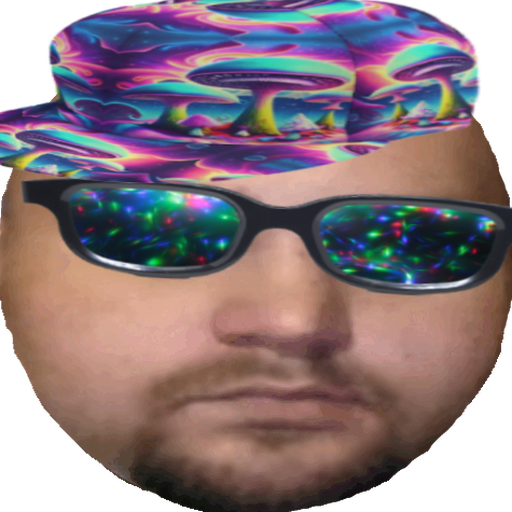
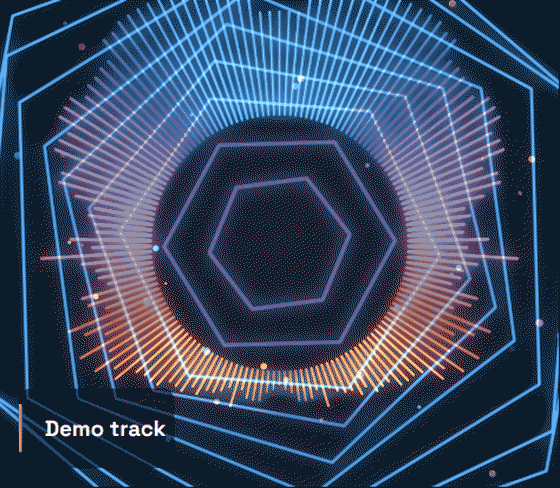
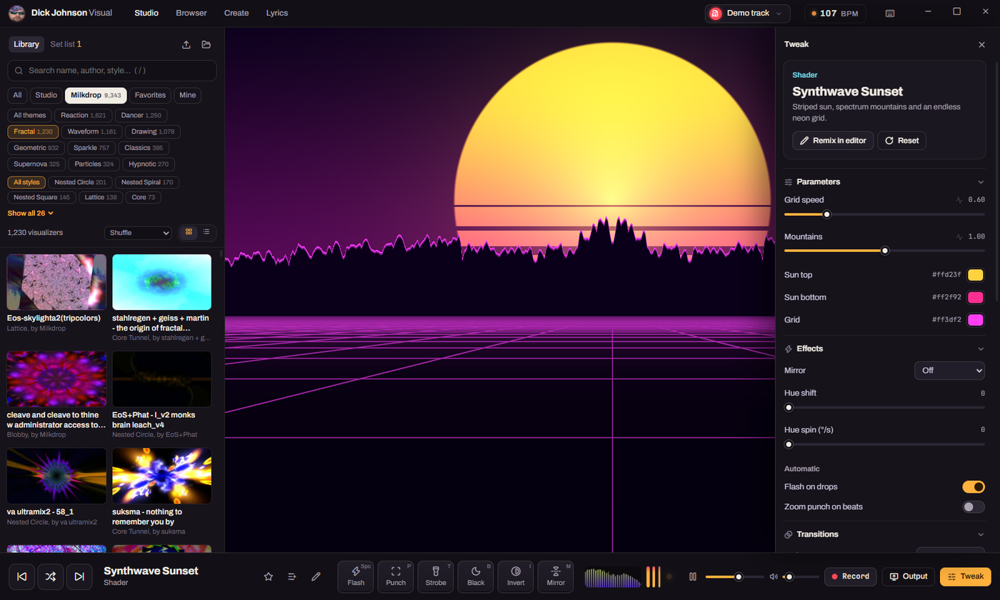
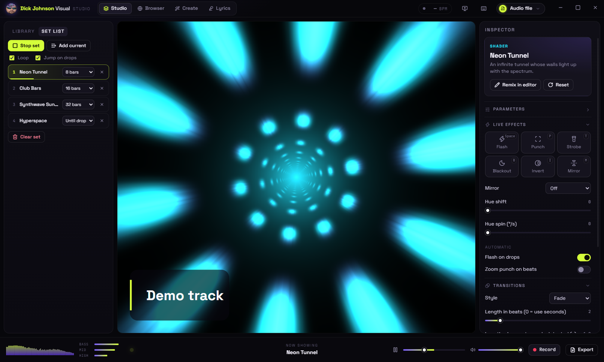
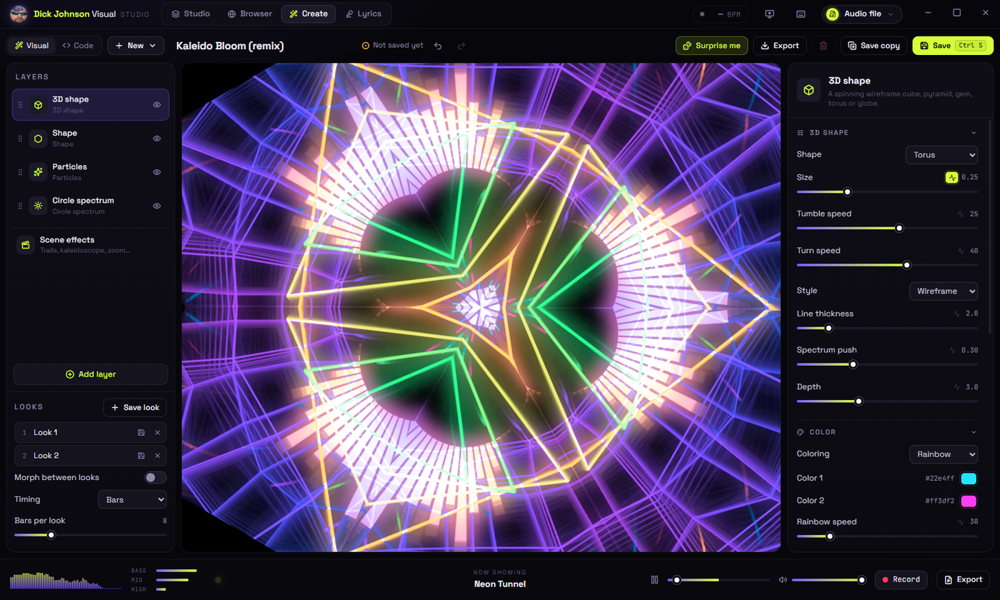
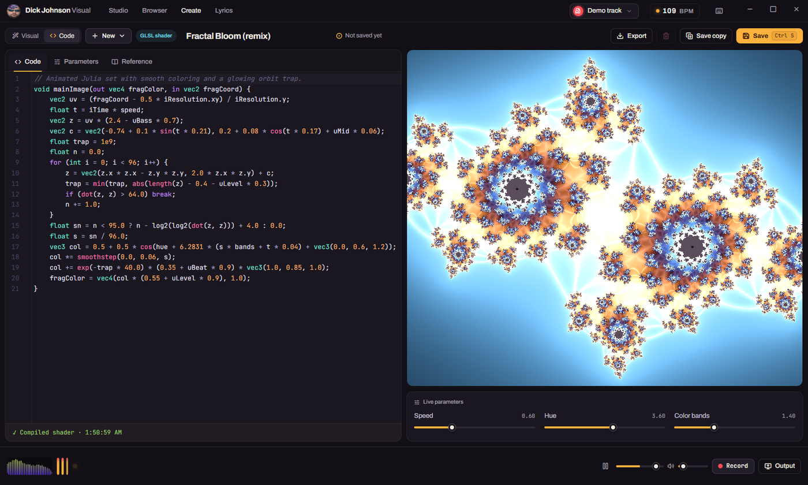
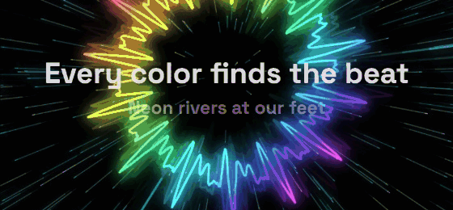
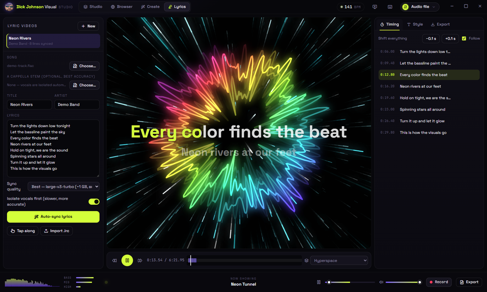
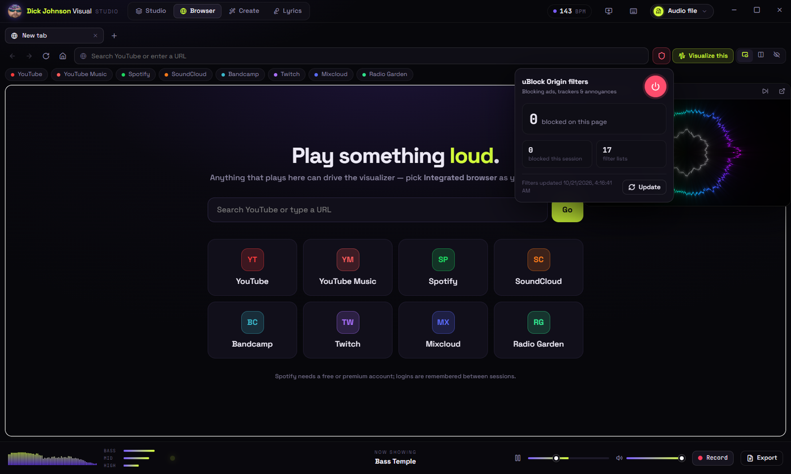

# Dick Johnson Visual Studio

**An audio visualizer studio for Windows.** Play with hundreds of visualizers, build your own with or without code, perform live with a set list and MIDI, and make synced lyric videos. It can react to the browser built into the app, to any running app, or to your whole desktop.

### [⬇ Download for Windows](https://github.com/JickDohnson/Dick-Johnson-Visual-Releases/releases/latest)

---

## Highlights

- **10,000+ visualizers.** Hand-made Canvas and GLSL shader visualizers, no-code scenes, about 400 classic **Milkdrop** presets, and the **Cream of the Crop** pack: thousands more Milkdrop presets sorted into themes such as Fractal, Dancer and Reaction, each with its own styles.
- **Browse by look.** The library is a wall of previews. Search by name, author or style (it forgives typos), filter by theme and style, and sort by recently or most played.
- **Any audio source.** Use the built-in browser (YouTube, Spotify, SoundCloud…), **one specific app** such as Spotify desktop or a game, full desktop audio, a microphone, or a file.
- **Make your own, no code needed.** Stack layers in the visual builder, or write JavaScript and GLSL with a live preview.
- **Built for performing.** Beat-synced set lists, transitions, live effects, keyboard and **MIDI** mapping, tempo detection, and a clean output window for projectors or OBS.
- **Lyric video generator.** Paste lyrics and it **syncs them word by word with on-device AI**, then renders a karaoke-style video.
- **Record and export.** Up to 4K MP4. Rendering from an audio file runs 3–7× faster than real time.

## Install

1. Download **`Dick_Johnson_Visual_setup.exe`** from the [latest release](https://github.com/JickDohnson/Dick-Johnson-Visual-Releases/releases/latest).
2. Run it. Because the installer isn't code-signed yet, Windows SmartScreen may warn you: click *More info → Run anyway*.
3. Launch **Dick Johnson Visual Studio** from the Start menu or the desktop.

**Updates are automatic.** The app checks for new versions when it starts and every few hours, then downloads them in the background. When one is ready, a **Restart to update** button appears in the title bar; otherwise it installs the next time you close the app. Click the logo to check right away.

**Requirements:** Windows 10 (version 2004) or Windows 11, 64-bit, and a GPU with WebGPU support for lyric syncing (most GPUs from 2016 on). About 500 MB of disk space, plus up to 2 GB for AI models if you use lyric sync.

## Studio

Browse the library, tweak every parameter live, and let it cycle on the beat. Any slider can follow the music: click its little wave icon and pick bass, drops, tempo, the left or right channel, and more.

## Perform live

- **Set list:** give each visualizer a length in bars (or "until the drop") and it switches on the downbeat, using the detected BPM. You can also tap the tempo yourself.
- **Transitions:** Fade, Zoom, Slide, Wipe, Spin and Glitch, timed in beats.
- **Live effects:** Flash, Zoom punch, Strobe, Blackout, Invert, Mirror modes and hue shift. They can also fire automatically on drops or beats.
- **Controls:** rebind any key, or click **Learn** and move a pad or knob on your MIDI controller.
- **Output window:** a UI-free 1080p feed for a second screen or projector, or for OBS Window Capture.
- **Now Playing:** shows the song title, artist and album art from the browser tab or the Spotify desktop app.

## Create without code

Stack layers in the visual builder:
- **Layer types:** spectrum bars, circle spectrum, waveform, particles, pulse rings, starfield, shapes, text, 3D wireframes, images/logos, video, and screen capture.
- **Scene effects:** kaleidoscope, trails, zoom and shake.
- **Looks:** save several looks and **morph** smoothly between them every few bars.
- **Sharing:** share any creation as a one-line code.

## Or write code

The editor takes Canvas 2D (JavaScript) or **Shadertoy-compatible GLSL**, with a live preview, inline errors, custom parameters, and a reference of every audio value (spectrum, waveform, beat, BPM, drops, stereo). You can remix any built-in visualizer.

## Lyric videos

Choose a song, paste the lyrics, and press **Auto-sync**. On your own GPU, the app:
1. **Isolates the vocals** with Demucs.
2. **Listens for word timings** with Whisper, only where someone is singing.
3. **Matches** what it heard to your lyrics.
4. **Repairs** anything that drifted.

You can then fine-tune lines and words in the timing editor, or tap along or import an `.lrc` file instead. Pick the font, colors, karaoke highlight and visualizer, then render 1080p, 4K or vertical video. You can also export `.lrc` / `.srt` files.

> Everything runs locally, through WebGPU on AMD, NVIDIA or Intel GPUs, with a CPU fallback. The AI models (~0.5–2 GB depending on quality) download once on first use. No audio or lyrics ever leave your PC.

## Built-in browser with ad blocking

The tabbed browser remembers logins and includes Widevine for Spotify. Its blocker uses **uBlock Origin's filter lists** (uBO filters, EasyList, EasyPrivacy and more) and handles YouTube ads, with per-site toggles. The visualizer can float picture-in-picture, sit side by side, or hide.

---

## Keyboard shortcuts (defaults, all rebindable)

| Key | Action | Key | Action |
| --- | --- | --- | --- |
| `←` `→` | Previous / next visualizer | `Space` | Flash |
| `R` | Random | `P` | Zoom punch |
| `F` | Fullscreen | `T` (hold) | Strobe |
| `S` | Favorite | `B` | Blackout |
| `E` | Open in editor | `I` / `M` | Invert / cycle mirror |
| `A` | Add to set list | `X` | Cycle transition |
| `Enter` | Play / stop set list | `1`–`9` | Jump to a set list entry |
| `O` | Output window | `C` | Toggle auto-cycle |

In the Lyrics section, `Space` plays or pauses and `←` / `→` seek.

## Your data

Everything you make stays on your PC in `%APPDATA%\Dick Johnson Visual\`. That folder holds your visualizers, lyric projects, settings and cached AI models; the Library's folder button opens the visualizers folder. Uninstalling the app leaves it in place, so reinstalling keeps your work.

## Credits

- **Milkdrop presets:** the classics from [butterchurn-presets](https://github.com/jberg/butterchurn-presets), and the [Cream of the Crop](https://github.com/projectM-visualizer/presets-cream-of-the-crop) pack curated by ISOSCELES (via projectM), converted with [milkdrop-preset-converter](https://github.com/jberg/milkdrop-preset-converter) (MIT). All presets belong to their original authors; a few that don't render in butterchurn are left out.
- **Built with:** [Electron](https://www.electronjs.org) (castlabs build with Widevine), [butterchurn](https://github.com/jberg/butterchurn), [Demucs](https://github.com/facebookresearch/demucs) (HTDemucs ONNX conversion by the Mixxx project and [smank/htdemucs-onnx](https://huggingface.co/smank/htdemucs-onnx)), [Whisper](https://github.com/openai/whisper) via [transformers.js](https://github.com/huggingface/transformers.js), the [Ghostery adblocker engine](https://github.com/ghostery/adblocker), CodeMirror, Lucide icons, and the Space Grotesk and JetBrains Mono fonts.
- **Filter lists:** uBlock Origin, EasyList and Peter Lowe. These are downloaded at runtime, not bundled.
